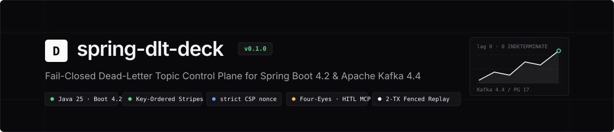
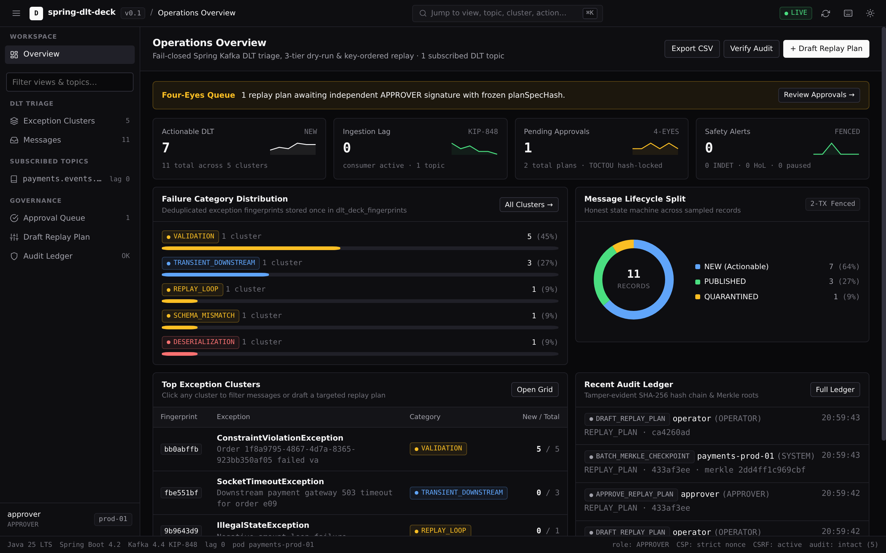
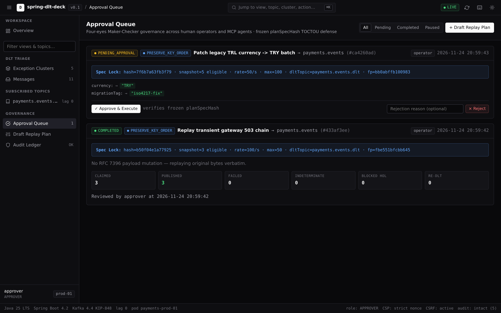
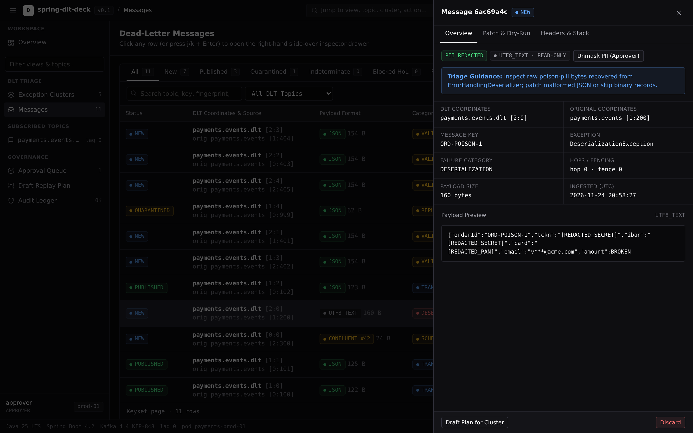
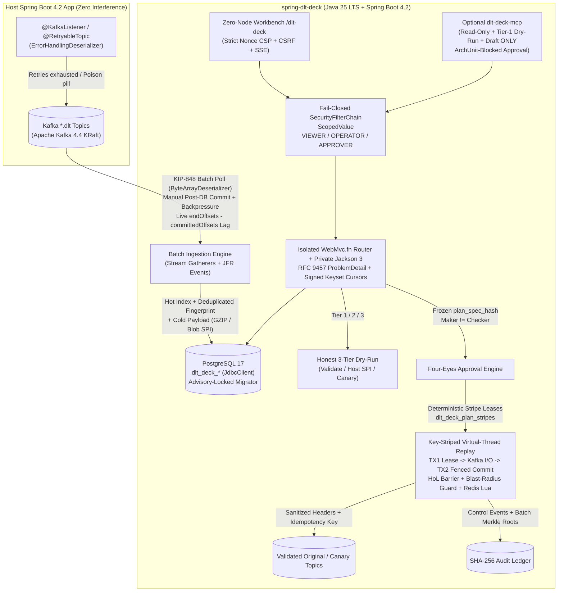
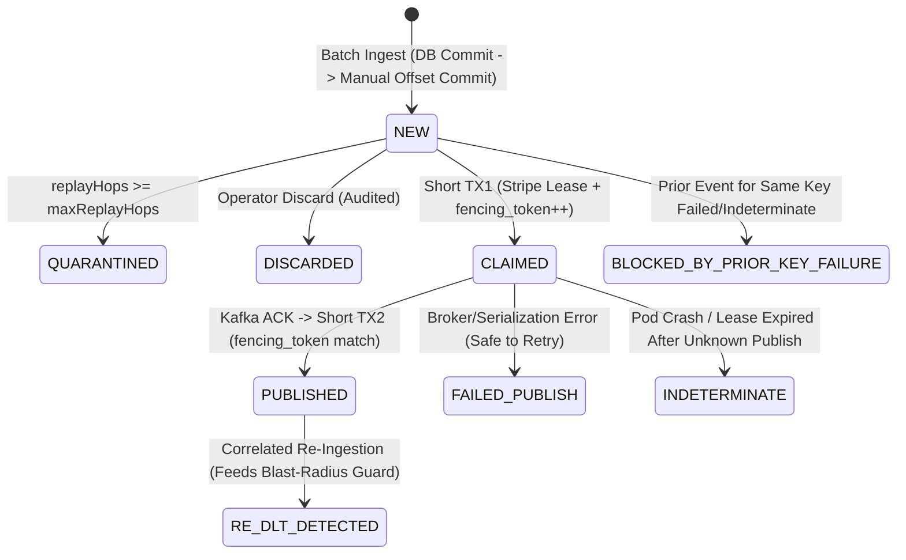

<p align="center">
  
</p>

<p align="center">
  <a href="https://github.com/duhanguler/spring-dlt-deck/actions/workflows/ci.yml"></a>
  
  
  
  
  
  
  <a href="LICENSE"></a>
</p>

<h3 align="center">
  Kafka UIs show you broken messages. <code>spring-dlt-deck</code> triages, redacts, dry-runs, four-eyes approves, and key-ordered replays them.<br />
  <sub>Zero Node build · Zero external CDN · Two short TXs + Fencing Token · Strict Nonce CSP · Fail-Closed HITL MCP Server</sub>
</h3>

---

<p align="center">
  <picture>
    <source media="(prefers-color-scheme: dark)" srcset="docs/assets/dashboard-dark.png" />
    <source media="(prefers-color-scheme: light)" srcset="docs/assets/dashboard-light.png" />
    
  </picture>
</p>

<table>
  <tr>
    <td width="50%">
      <strong>Four-Eyes Approval Queue (<code>/dlt-deck</code>)</strong><br />
      <sub>Frozen <code>planSpecHash</code> TOCTOU lock, inline RFC 7396 merge patch diff chips, maker≠checker enforcement &amp; key-striped replay telemetry.</sub>
      
    </td>
    <td width="50%">
      <strong>Messages Grid &amp; Slide-Over Poison-Pill Inspector</strong><br />
      <sub>Checksum-verified <code>PII REDACTED</code> preview, Confluent <code>#42</code> <code>NOT_PATCHABLE</code> guard, 3-Tier Dry-Run &amp; signed keyset pagination.</sub>
      
    </td>
  </tr>
</table>

## Why `spring-dlt-deck` Exists

When a production Spring Kafka consumer hits a poison pill, schema drift, or downstream 503 outage, thousands of events pile up in `*.dlt` topics. Generic Kafka browsers only let you inspect raw bytes or blindly re-produce them — leaving teams exposed to **HikariCP starvation**, **silent double-replays after mid-publish pod crashes**, **per-key out-of-order state corruption**, **unredacted PII leaks**, and **Confluent Avro/Protobuf binary corruption**.

`spring-dlt-deck` is a **Java 25 LTS + Spring Boot 4.2 + Apache Kafka 4.4** control plane built with honest distributed-systems invariants — deployable either as a **zero-interference embedded Spring Boot Starter** or as a **standalone control plane** (Docker / Kubernetes Helm).

### How It Compares

| Capability | Generic Kafka UI / AKHQ | Ad-Hoc Replay Scripts | **`spring-dlt-deck`** |
| :--- | :---: | :---: | :---: |
| **Two Short TXs + Fencing Token + Honest `INDETERMINATE`** *(zero DB conn held during Kafka I/O; never silently double-replays crashes)* | No | No | **Yes** ([ADR-001](docs/adr/ADR-001-two-short-tx-fencing-and-indeterminate.md)) |
| **Multi-Pod Key-Ordered Stripe Leasing + Per-Key HoL Barrier** | No | No | **Yes** ([ADR-002](docs/adr/ADR-002-deterministic-stripe-leasing-and-hol-barrier.md)) |
| **`ErrorHandlingDeserializer` Raw Poison-Pill Recovery** *(JEP 290/415 `ObjectInputFilter`)* | Partial | Manual | **Yes** |
| **Confluent `0x00` Wire Format `NOT_PATCHABLE` Guard & Tombstone Support** | Partial | No | **Yes** |
| **3-Table Hot/Cold/Deduplicated PostgreSQL Schema** *(50k duplicates = 8 KB stacktrace)* | N/A | No | **Yes** ([ADR-003](docs/adr/ADR-003-hot-cold-schema-and-batch-merkle-audit.md)) |
| **Checksum-Verified PII Redaction** *(TCKN, IBAN, Luhn PAN, JWT, email, phone)* | No | No | **Yes** |
| **Honest 3-Tier Dry-Run** *(Validate / Host SPI / Canary Topic)* + **RFC 7396 Merge Patch** | No | No | **Yes** |
| **Four-Eyes Maker-Checker Approval + Frozen `planSpecHash` (TOCTOU Defense)** | No | No | **Yes** |
| **Tamper-Evident SHA-256 Audit Chain + Batch Merkle Checkpoints** | No | No | **Yes** |
| **Zero-Interference Embedded Spring Boot 4.2 Starter** *(Zero global `WebMvcConfigurer`)* | N/A | N/A | **Yes** ([ADR-004](docs/adr/ADR-004-strict-spring-boot-starter-isolation.md)) |
| **ArchUnit-Verified Fail-Closed HITL MCP Server for AI Incident Triage** | No | No | **Yes** ([ADR-005](docs/adr/ADR-005-fail-closed-mcp-and-jep290-hardening.md)) |

---

## Architecture & Honest Replay State Machine





---

## 60-Second Quickstart

### Option A: Live Full-Stack Demo (Docker Compose)

Spin up **Apache Kafka 4.0 KRaft + PostgreSQL 17 + Redis 7 + Prometheus + Grafana + `dlt-deck-demo`** (packaged with **Java 25 AOT Cache JEP 514/515 + `-XX:+UseCompactObjectHeaders` JEP 519**):

```bash
git clone https://github.com/duhanguler/spring-dlt-deck.git
cd spring-dlt-deck/dlt-deck-demo
docker compose up -d --build
```

1. **Trigger all 5 production chaos scenarios** (same-key ordered chain `Created -> Authorized -> Captured`, `ErrorHandlingDeserializer` corrupt JSON with TCKN/IBAN/PAN PII, Confluent `0x00` binary `#42`, 5 patchable validation failures, and a hop-3 replay loop):
   ```bash
   curl -X POST http://localhost:8080/api/chaos/trigger
   ```
2. **Open the embedded Precision Workbench:** `http://localhost:8080/dlt-deck`
   - `viewer` / `viewer123` (`ROLE_DLT_VIEWER`) — read-only, PII masked
   - `operator` / `operator123` (`ROLE_DLT_OPERATOR`) — RFC 7396 patch, 3-Tier Dry-Run, draft replay plans
   - `approver` / `approver123` (`ROLE_DLT_APPROVER`) — four-eyes approval, audited PII unmask, `INDETERMINATE` resolution
3. **Inspect live observability:** `/actuator/dltdeck`, `/actuator/health`, `/actuator/prometheus`, Grafana at `http://localhost:3000` (`admin`/`admin`).

*(If ports `5432`, `6379`, `8080`, or `9092` are already in use on your host, override via `DLT_DECK_APP_PORT`, `DLT_DECK_PG_PORT`, `DLT_DECK_REDIS_PORT`, `DLT_DECK_KAFKA_PORT`, `DLT_DECK_PROM_PORT`, `DLT_DECK_GRAFANA_PORT`.)*

---

### Option B: Drop-In Spring Boot 4.2 Starter (Zero Host Interference)

Add the starter to your Spring Boot 4.2 application:

```xml
<dependency>
    <groupId>io.github.duhanguler</groupId>
    <artifactId>dlt-deck-spring-boot-starter</artifactId>
    <version>0.1.0</version>
</dependency>
```

Configure in `application.yml`:

```yaml
dlt:
  deck:
    enabled: true
    base-path: /dlt-deck
    ingestion:
      topic-patterns:
        - ".*\\.dlt$"
      max-replay-hops: 3
    replay:
      stripe-count: 8
      require-four-eyes-approval: true
      validate-target-topic-exists: true
    storage:
      auto-migrate: true          # Isolated dlt_deck_schema_history via pg_advisory_lock
      gzip-compression: true
      cursor-hmac-secret: "${DLT_DECK_CURSOR_SECRET}"
    redis:
      enabled: false              # Set true with dlt-deck-storage-redis for cluster-wide Lua rate limits
```

Optional consumer-side deduplication for end-to-end effective exactly-once across `INDETERMINATE` manual recoveries:

```java
@KafkaListener(topics = "payments.events")
public void onPayment(ConsumerRecord<String, String> record) {
    if (!idempotentReplayFilter.shouldProcess(record)) {
        return; // Deduplicated via x-dlt-deck-idempotency-key
    }
    // ... business logic
}
```

Optional opt-in **Tier-2 Dry-Run SPI** for domain validation without side effects:

```java
@Component
public class PaymentDryRunHandler implements DltDryRunHandler {
    @Override
    public boolean supports(String targetTopic) {
        return "payments.events".equals(targetTopic);
    }

    @Override
    public HandlerResult dryRun(String targetTopic, DltMessageDetail message, byte @Nullable [] candidatePayload) {
        // Side-effect-free domain invariant checks
        return new HandlerResult(true, "Payment payload valid", List.of());
    }
}
```

---

## Multi-Module Architecture

| Module | Purpose | Isolation / Key Tech |
| :--- | :--- | :--- |
| [`dlt-deck-bom`](dlt-deck-bom) | Bill of Materials | Clean downstream version alignment |
| [`dlt-deck-core`](dlt-deck-core) | Pure Java 25 domain engine | **Zero** Spring/Servlet/JDBC/JPA/Kafka imports; `ScopedValue` (JEP 506), `Stream.gather` (JEP 485), JEP 513, JFR Events, `97.6%` line / `93.8%` branch coverage |
| [`dlt-deck-storage-jdbc`](dlt-deck-storage-jdbc) | 3-table hot/cold/dedup persistence | Spring `JdbcClient` + `batchUpdate()`, advisory-locked `DltDeckSchemaMigrator`, GZIP + `PayloadBlobStore` SPI, `FOR UPDATE SKIP LOCKED` stripe leasing, PostgreSQL 17 & H2 |
| [`dlt-deck-storage-redis`](dlt-deck-storage-redis) | Optional global rate limiter | Atomic Lua token-bucket script for multi-pod clusters |
| [`dlt-deck-spring-boot-starter`](dlt-deck-spring-boot-starter) | Drop-in Spring Boot 4.2 starter | Isolated WebMvc.fn router, private Jackson 3, `@Qualifier("dltDeckInternal")` Kafka 4.4 KIP-848 engine, JEP 290 `ObjectInputFilter`, CSRF/Nonce CSP, zero-Node UI, Actuator, AOT `RuntimeHints` |
| [`dlt-deck-mcp`](dlt-deck-mcp) | Optional fail-closed HITL MCP server | Read-only triage, Tier-1 dry-run & `PENDING_APPROVAL` drafting only — compile & ArchUnit-blocked approval/unmasking |
| [`dlt-deck-test-support`](dlt-deck-test-support) | JUnit 6 + AssertJ CI guardrails | `assertNoPoisonPills`, `assertKeyOrderPreserved`, `assertAuditChainIntact`, `assertNoIndeterminateOrDuplicates` |
| [`dlt-deck-benchmarks`](dlt-deck-benchmarks) | JMH 1.37 microbenchmarks | Standard vs. Java 25 `-XX:+UseCompactObjectHeaders` (JEP 519) |
| [`dlt-deck-demo`](dlt-deck-demo) | E-Commerce/Payments showcase | Spring Framework 7 Native API Versioning, Hibernate 7 + Flyway side-by-side, 5-scenario Chaos Sim, Java 25 AOT Cache Dockerfile + Compose |
| [`deploy/helm`](deploy/helm/spring-dlt-deck) | Production Kubernetes Helm chart | HPA, PDB, NetworkPolicy, non-root readOnlyRootFilesystem, ServiceMonitor |

---

## Real Measured Benchmarks & Verification

Measured directly on **OpenJDK 25.0.5.1 (Ubuntu 24.04 x86_64)** with **JMH 1.37** (see [docs/BENCHMARKS.md](docs/BENCHMARKS.md)):

| Operation | Standard Headers | `-XX:+UseCompactObjectHeaders` (JEP 519) | Throughput |
| :--- | :---: | :---: | :---: |
| Confluent `0x00` binary sniff + `NOT_PATCHABLE` guard | `0.186 µs/op` | **`0.178 µs/op`** | **~5.6M ops/s** |
| Strict UTF-8 + Jackson 3 JSON sniff | `1.720 µs/op` | `1.788 µs/op` | **~560k ops/s** |
| Exception SHA-256 fingerprinting & stack normalization | `18.320 µs/op` | `18.596 µs/op` | **~54k ops/s** |
| Checksum-verified PII redaction (TCKN/IBAN/PAN/JWT) | `51.784 µs/op` | **`49.991 µs/op`** | **~20k ops/s** |
| 50-record SHA-256 Merkle batch checkpoint | `70.602 µs/op` | **`65.277 µs/op`** | **~765k msgs/s** |

### Run Full Verification Locally

```bash
# Static analysis (ErrorProne 2.53 + NullAway 0.14.4 JSpecify), Spotless, Unit + jqwik Fuzzing,
# ArchUnit JUnit 6, JaCoCo (>=85% line / >=80% branch), CycloneDX SBOM, and
# Live Testcontainers 2.0.5 (Apache Kafka 4 KRaft + PostgreSQL 17 + Redis 7) Fault-Injection ITs:
./mvnw clean verify -Psbom
```

---

## Architecture Decision Records (ADRs)

- [ADR-001: Two Short Transactions + Fencing Token + `INDETERMINATE` Crash Semantics](docs/adr/ADR-001-two-short-tx-fencing-and-indeterminate.md)
- [ADR-002: Deterministic Multi-Pod Stripe Leasing + Per-Key Head-of-Line Barrier](docs/adr/ADR-002-deterministic-stripe-leasing-and-hol-barrier.md)
- [ADR-003: 3-Table Hot/Cold/Deduplicated PostgreSQL Schema & Batch Merkle Audit](docs/adr/ADR-003-hot-cold-schema-and-batch-merkle-audit.md)
- [ADR-004: Strict Spring Boot 4.2 Starter Isolation Boundary](docs/adr/ADR-004-strict-spring-boot-starter-isolation.md)
- [ADR-005: Fail-Closed HITL MCP Governance & JEP 290/415 `ObjectInputFilter` Hardening](docs/adr/ADR-005-fail-closed-mcp-and-jep290-hardening.md)

---

## Security & Contributing

- **Security:** See [SECURITY.md](SECURITY.md) for responsible disclosure and built-in controls (Strict Nonce CSP, CSRF, `Cache-Control: no-store`, TOCTOU `planSpecHash`, JEP 290 `ObjectInputFilter`, HMAC keyset cursors, CSV formula neutralization).
- **Contributing:** PRs and architectural discussions are welcome — see [CONTRIBUTING.md](CONTRIBUTING.md).
- **License:** Licensed under the [Apache License, Version 2.0](LICENSE).
